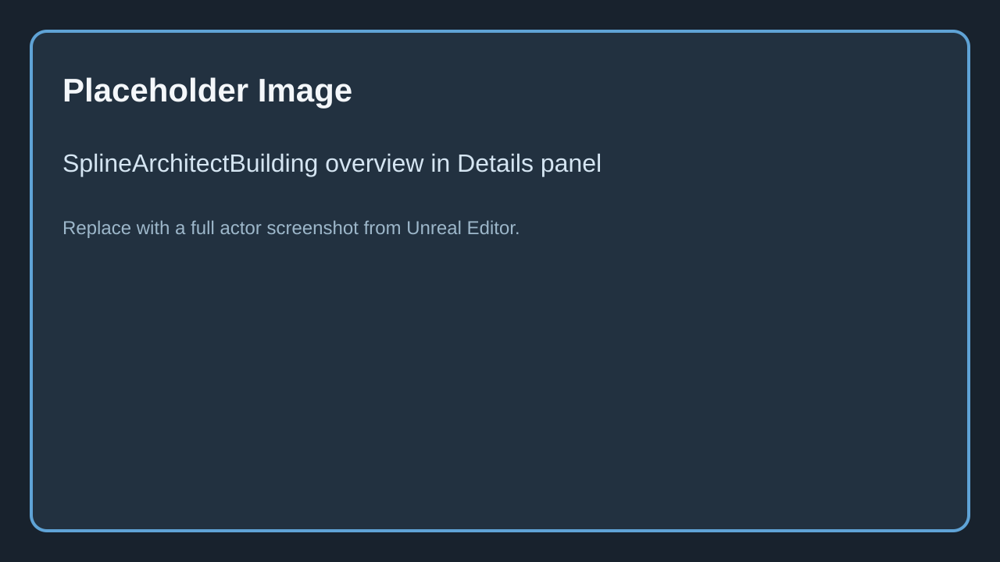
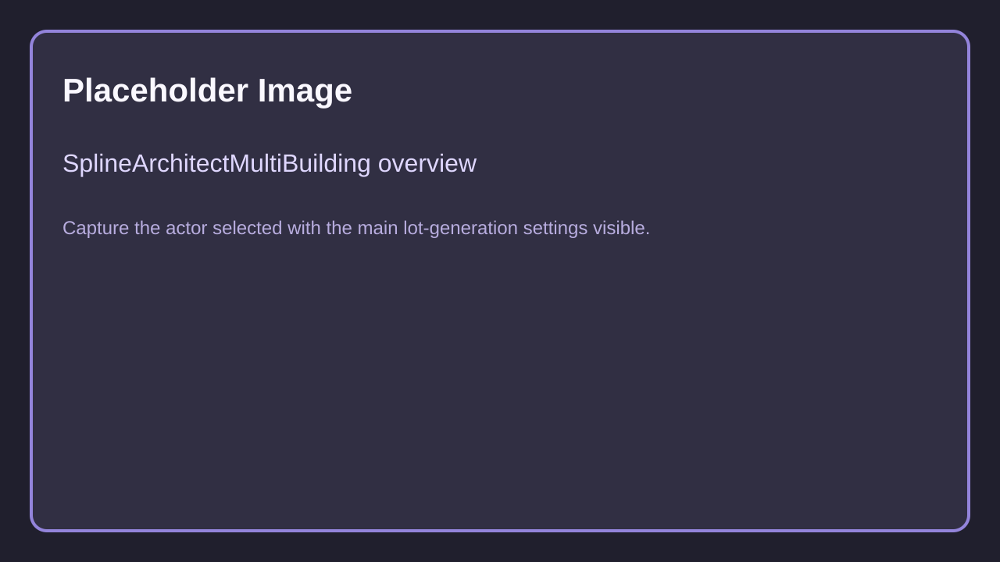
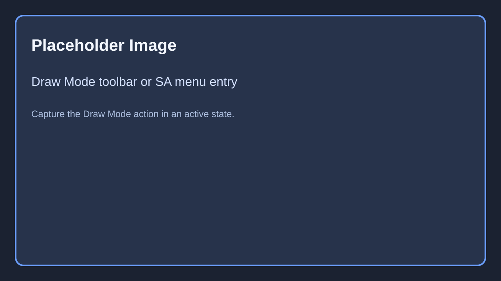
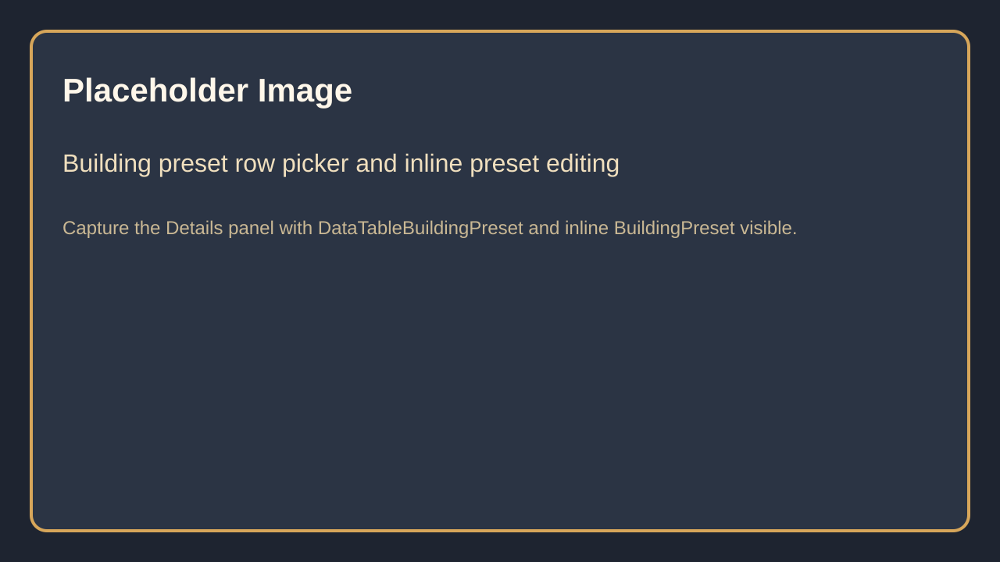
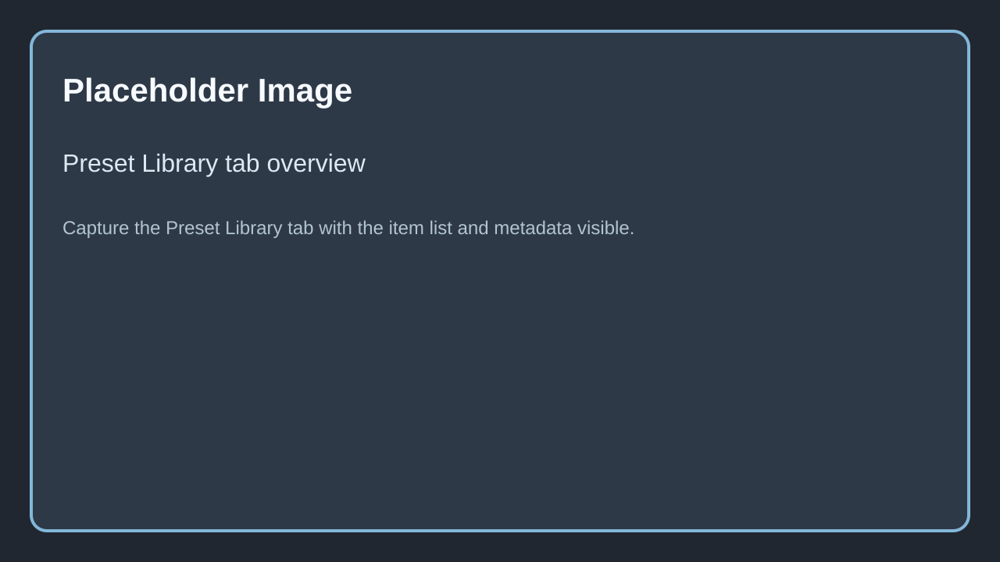

# How does it work?

---

## Operating principle

| Description | Example |
|-------------|---------|
| Spline Architect places modular meshes and generated surfaces along author-owned spline paths. The same core idea is used by `SplineArchitectWall`, `SplineArchitectBuilding`, and `SplineArchitectMultiBuilding`. |  { width="200px" } |
| `SplineArchitectWall` generates wall meshes, corners, floors, roofs, and posts from a single wall preset and spline. |  { width="200px" } |
| `SplineArchitectBuilding` uses one spline plus a `BuildingPreset` to spawn a coordinated stack of wall presets and attached custom pieces. |  { width="200px" } |
| `SplineArchitectMultiBuilding` subdivides a closed spline area into lots, then spawns building presets or wall presets per pass. |  { width="200px" } |
| Generation usually happens in actor construction and editor refresh passes. In baked mode, generated one-time meshes are converted to static components so the actor stops rebuilding every load. |  { width="200px" } |
| Editor tooling extends the workflow with Draw Mode, preset browsing, convert tools, and mesh collapse actions. |  { width="200px" } |

---

## Important nuances

| Description | Example |
|-------------|---------|
| Modular wall meshes should generally have their length on X, centered pivots on X/Y, and their pivot sitting on the floor along Z. |   |
| `SplineArchitectWall` can work with open splines, but `SplineArchitectBuilding` and `SplineArchitectMultiBuilding` make the most sense with closed building footprints. |  { width="200px" } |
| Unbaked actors rely on plugin-side generation. If a shipped project should not depend on runtime construction, bake or convert the content before packaging. |  { width="200px" } |
| Preset-driven workflows now extend beyond wall presets. The plugin also supports building presets and a Preset Library asset that stores metadata, favorites, and drag-drop spawning. |  { width="200px" } |

See also: [SplineArchitectBuilding](../2.Overview/Components/8.Spline-Architect-Building.md), [SplineArchitectMultiBuilding](../2.Overview/Components/9.Spline-Architect-Multi-Building.md), [Draw Mode](../2.Overview/Components/10.Draw-Mode.md), [Preset Library](../2.Overview/Components/11.Preset-Library.md).
