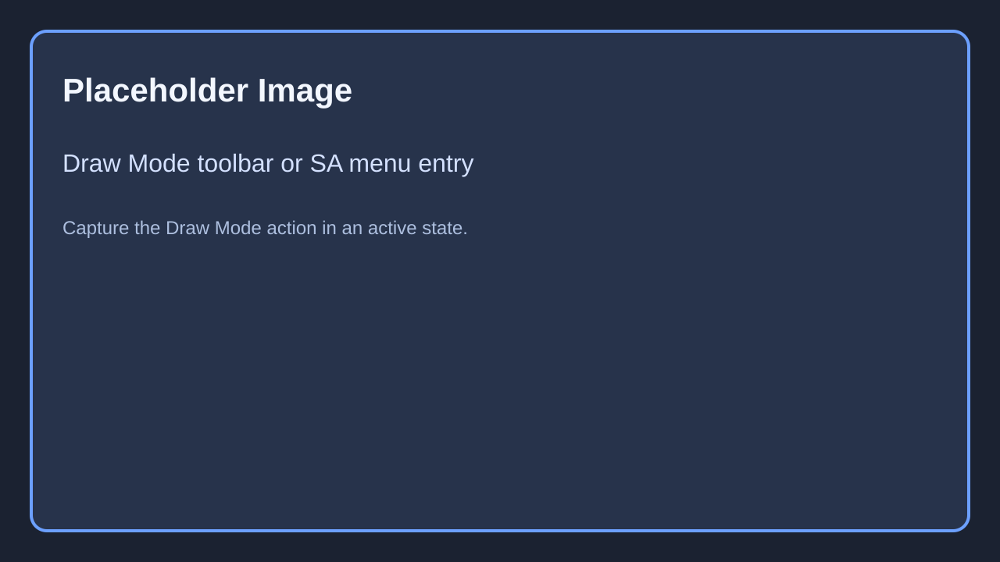
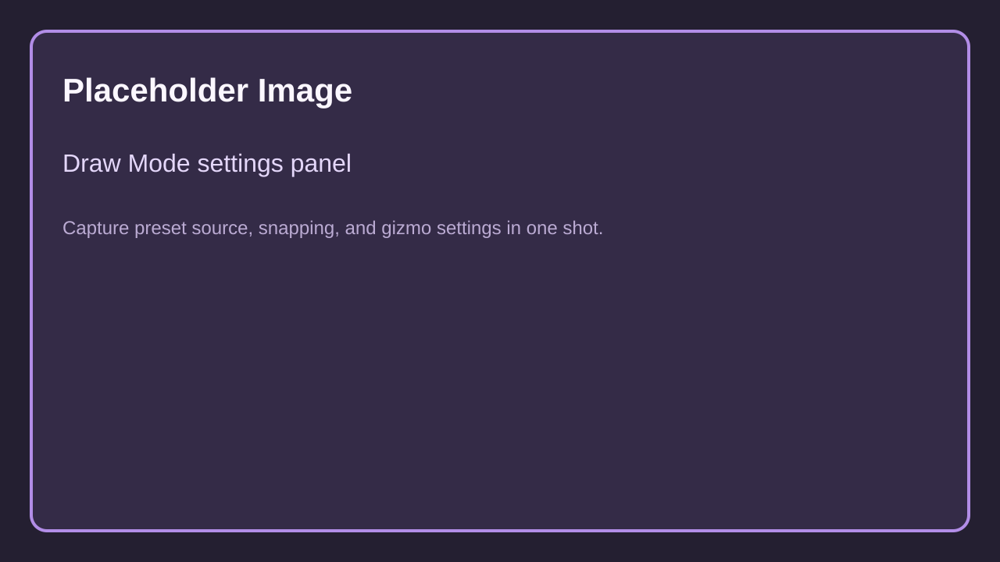
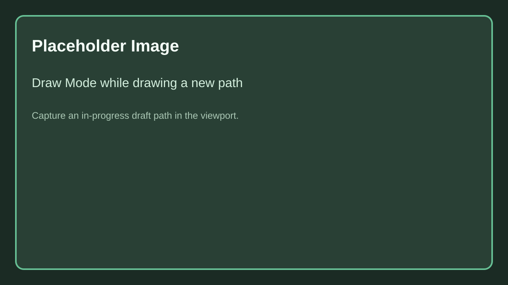
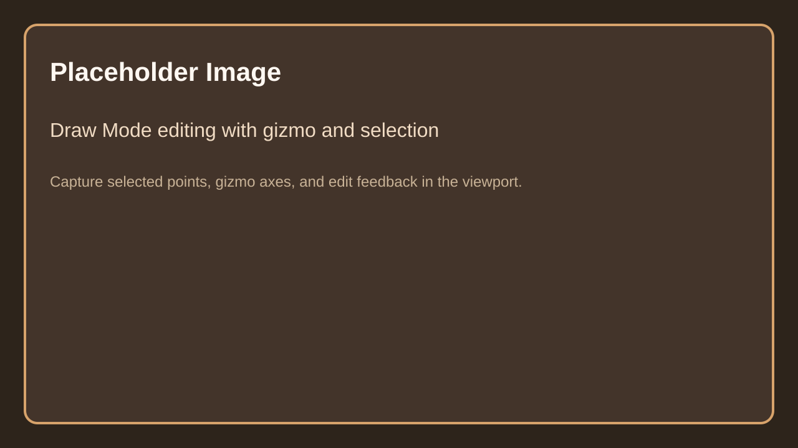

# Draw Mode

`Draw Mode` is the editor viewport mode used to draw new spline-based content or edit existing supported spline hosts directly in the viewport.

It is backed by `USplineArchitectDrawModeSettings`, so most of the behavior described here is persistent per project user settings.

Caption: Replace with a screenshot of the Draw Mode entry in the SA menu or toolbar while the mode is active.

## 1. Working modes

`Draw Mode` supports two main working modes:

| Mode | Explanation |
|------|-------------|
| `Draw New` | Creates a new supported actor from viewport clicks. |
| `Edit Selected` | Tracks a selected supported actor and edits its spline points in place. |

The mode can also auto-track selection while in edit mode if `bAutoTrackSelectionInEditMode` is enabled.

## 2. Preset source

When drawing new content, the mode can use either:

- `Wall Preset DataTable`
- `Building Preset DataTable`

This decides whether the newly drawn actor is created from a wall preset or a building preset.

Caption: Replace with a screenshot of Draw Mode settings showing preset source, snapping, and edit gizmo settings.

## 3. Placement profiles

| Profile | Explanation |
|---------|-------------|
| `Planar Locked` | Keeps drawing on a locked plane, useful for top-down footprint work. |
| `Planar From Hit` | Builds the drawing plane from the hit location you start from. |
| `Surface Projected` | Projects points to hit surfaces instead of staying on one plane. |

Related settings include:

- `GridStep`
- `bGridSnapEnabled`
- `SurfaceOffsetFromHit`
- `bIgnoreSelectedActorWhenProjecting`

## 4. Drawing workflow

In `Draw New`, the tool:

- resolves a cursor point from the viewport
- snaps according to the active placement profile and grid settings
- starts a draft actor when the first click is placed
- appends committed points until the shape is finalized

Caption: Replace with a viewport screenshot of Draw Mode while drawing a new path.

## 5. Editing workflow

In `Edit Selected`, the tool edits the spline of the selected supported actor directly.

Main edit behavior:

- point selection by screen distance
- segment selection
- rectangle selection
- add or remove points
- translate selected points with the edit gizmo

The edit gizmo can work in:

- `World`
- `Actor`
- `Spline Segment`

It also supports preview grid display and configurable axis select distances and axis lengths.

Caption: Replace with a viewport screenshot of Draw Mode editing selected spline points with gizmo and selection feedback visible.

## 6. Display and feedback

Draw Mode can show:

- viewport help text
- point indices
- debug line thickness
- arrow size
- marker size

It also tracks snapping feedback such as endpoint snapping and edit target state.

## 7. Best use cases

Use Draw Mode when:

- you want to sketch a new wall or building footprint directly in the viewport
- you want to edit selected spline hosts without switching between details and spline widgets
- you need consistent snapping, projection, and gizmo behavior across several authoring actors

## Needed Images

- Draw Mode toolbar or menu entry with active mode state
- Draw Mode settings panel with preset source, snapping, and gizmo sections visible
- Draw Mode in viewport while drawing a new path
- Draw Mode in viewport while editing points with gizmo and selection

Full checklist: [Needed Images](../../5.Reference/1.Needed-Images.md)
