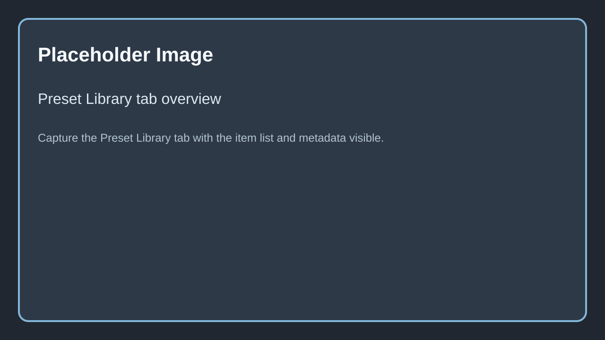
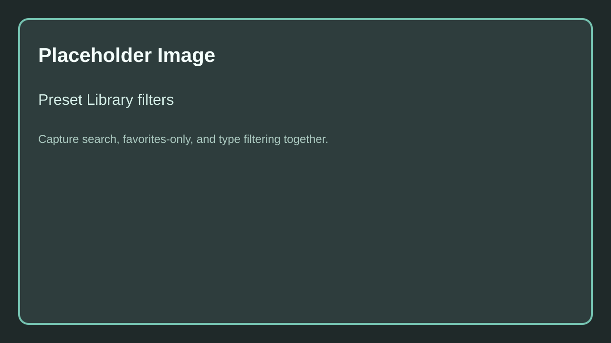
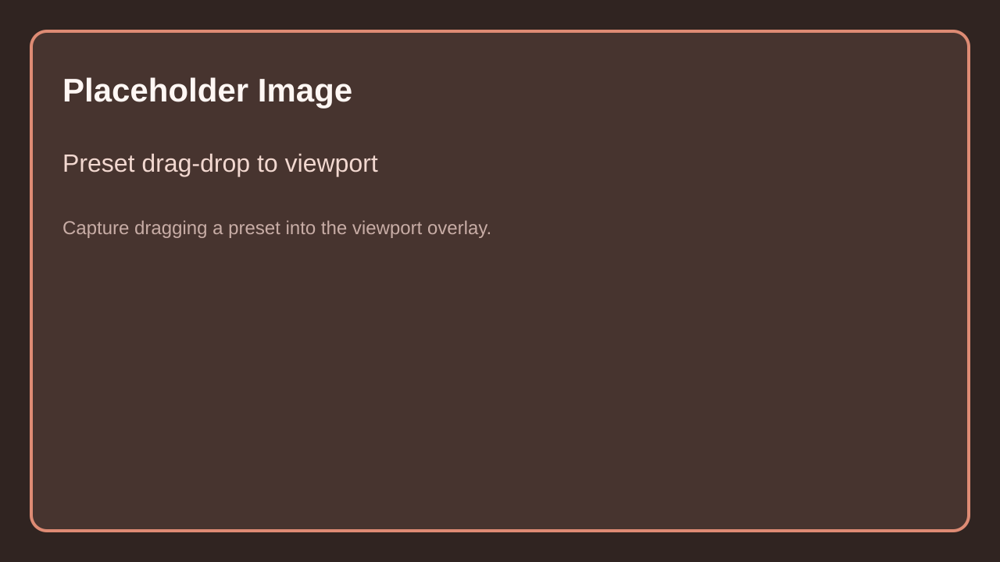

# Preset Library

The **Preset Library** is the current editor-facing preset browser and metadata layer for Spline Architect presets.

It is built on top of:

- DataTables that store the actual wall and building preset rows
- the `USplineArchitectPresetLibrary` data asset, which stores metadata such as display names, descriptions, tags, favorites, and thumbnails
- the editor subsystem that resolves, applies, duplicates, renames, and deletes presets

Caption: Replace with a screenshot of the Preset Library tab with the preset list visible.

## 1. What the library stores

Each library entry contains:

- a preset key: preset type, source DataTable, and row name
- metadata: display name, description, tags, favorite flag, and thumbnail

The library currently supports these preset types:

- `Wall`
- `Building`
- `Custom Piece`

## 2. Main operations

The Preset Library tab supports the following workflows through the editor subsystem:

| Action | Explanation |
|--------|-------------|
| `Refresh` | Rebuilds the preset list from the source library asset and DataTables. |
| `Save From Selection` | Creates or captures a preset from the current selection. |
| `Overwrite` | Rewrites an existing preset from the current selection. |
| `Duplicate` | Creates a copy of an existing preset entry. |
| `Rename` | Renames the selected preset entry. |
| `Delete` | Removes the preset entry. |
| `Open Source` | Opens the source DataTable backing the selected preset. |

## 3. Filtering and browsing

The tab supports:

- text search
- favorites-only filtering
- type filtering

Caption: Replace with a screenshot showing search, favorites-only filtering, and type filter options in the Preset Library tab.

This is the main difference from the older SaveGame-first preset widget flow: the current workflow is designed for a browsable, metadata-rich preset collection instead of only temporary copy-paste storage.

## 4. Applying presets

The subsystem can apply presets directly to:

- `SplineArchitectWall`
- `SplineArchitectBuilding`
- `SplineArchitectCustomPiece`

This keeps actor authoring aligned with the same preset source used by the library.

## 5. Viewport drag-drop

When the Preset Library tab is open, the editor registers a viewport overlay that accepts preset drag-drop actions.

Dragging a preset into the viewport lets the subsystem spawn or apply the corresponding content at the drop location.

Caption: Replace with a screenshot of dragging a preset from the Preset Library tab into the viewport.

## 6. Project setup note

The active preset library asset path comes from **Project Settings -> Spline Architect Settings**. If the explicit library reference is unset, the plugin can fall back to the configured default asset path.

## Needed Images

- Preset Library tab overview
- Preset Library filtering and favorites example
- Preset drag-drop from the library into the viewport

Full checklist: [Needed Images](../../5.Reference/1.Needed-Images.md)
