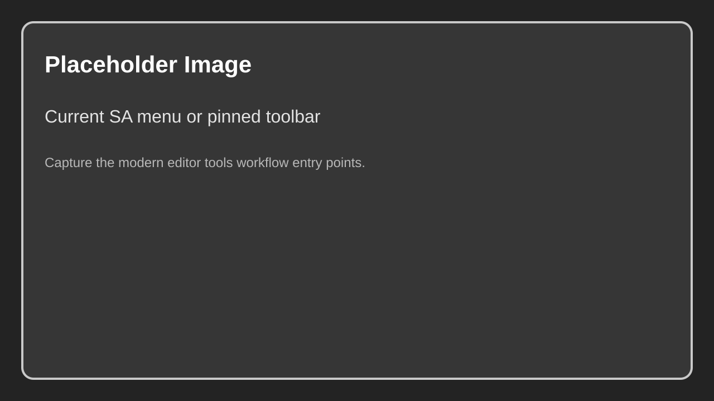

# Widgets and Editor Tools

Spline Architect now ships with a broader editor tooling workflow than the original utility widget-only setup. The current plugin experience is centered around the **SA** menu, toolbar pins, **Draw Mode**, and the **Preset Library** tab.

Widgets can still be part of older projects or content packs, but the editor module is the current source of truth for the supported create, spline, bake, convert, and preset workflows.

{ width="150px" }

## Where to find the tools

- **Main menu:** `SA`
- **Viewport/editor mode:** `Draw Mode`
- **Tab:** `Preset Library`
- **Utility actions:** available through the `SA` submenus and optional pinned toolbar buttons

Caption: Replace with a screenshot of the current `SA` menu or pinned toolbar showing Draw Mode, Add Building, Add MultiBuilding, Presets, and Documentation.

## Create

The **Create** section is used to spawn authoring actors into the level:

| Button | Explanation |
|--------|-------------|
| `Add Spline Wall` | Spawns a `SplineArchitectWall` and ensures it has a usable spline host. |
| `Add Building` | Spawns a `SplineArchitectBuilding` for footprint-based building generation. |
| `Add MultiBuilding` | Spawns a `SplineArchitectMultiBuilding` for lot subdivision and repeated spawning. |
| `Add Wall to Selected` | Adds a child wall to the selected supported wall stack. |
| `Add CustomPiece` | Spawns a `SplineArchitectCustomPiece`, usually attached to the selected compatible actor. |
| `Add Boolean` | Spawns a `SplineArchitectBoolean` and can wire it into compatible wall usage. |

## Destroy and cleanup

| Button | Explanation |
|--------|-------------|
| `Clean Selected` | Cleans supported selected Spline Architect content back to a simpler authored state. |
| `Delete Invalid` | Removes invalid or broken Spline Architect content discovered by the editor tool. |

## Selection helpers

| Button | Explanation |
|--------|-------------|
| `Select Roots` | Selects root wall, building, or multibuilding actors from the current selection. |
| `Select Connected` | Expands the selection across attached compatible actors. |
| `Walls / Pieces / Other` | Filters what `Select Connected` is allowed to include. `Walls` also covers buildings and multibuildings. |

## Spline tools

The **Spline** submenu applies to supported spline hosts, including walls, buildings, and multibuildings where relevant.

| Button | Explanation |
|--------|-------------|
| `Set Spline From Shape` | Extracts a spline shape from a mesh in the BasicShapes set and applies it to the selected actor. |
| `Refresh Shape Cache` | Refreshes the cached list of available BasicShapes meshes. |
| `Gridify` | Snaps spline points to the actor grid size. |
| `Flatten` | Sets spline point Z values to a flat plane. |
| `Reverse` | Reverses spline point order. |
| `Mirror X` | Mirrors spline points along local X. |
| `Mirror Y` | Mirrors spline points along local Y. |
| `Reset Actor Transform` | Resets the actor transform using the current spline. |
| `Center Actor Transform` | Re-centers the actor to the spline footprint. |

## Bake

[More on baking](../Concepts/baking.md)

| Button | Explanation |
|--------|-------------|
| `Unbake Connected` | Unbakes supported selected actors and connected compatible stacks. |
| `Rebake Connected` | Forces a fresh bake on supported selected actors and connected compatible stacks. |
| `Unbake All` | Unbakes all Spline Architect root actors in the level. |
| `Rebake All` | Rebuilds and bakes all Spline Architect root actors in the level. |
| `Bake Unbaked` | Bakes only actors that are still unbaked. |

## Convert and collapse

[More on converting](../Concepts/converting.md)

| Button | Explanation |
|--------|-------------|
| `Convert Selected...` | Converts selected Spline Architect content into plain UE actors and components. |
| `Convert All...` | Converts all compatible content in the level. |
| `Collapse Selected to Mesh` | Merges the selected generated output into a new static mesh asset. |
| `Collapse Each to Mesh` | Creates one merged static mesh asset per selected root scope. |

The convert dialog supports grouping and output-mode decisions such as instanced output, hierarchical instanced output, or individual components.

## Tools

| Button | Explanation |
|--------|-------------|
| `Draw Mode` | Toggles the custom viewport draw/edit mode. |
| `PivotTool` | Opens the pivot adjustment utility. |
| `ParametersChanger` | Opens the bulk parameter-changing tool if present in your setup. |
| `Presets` | Opens the Preset Library tab. |
| `Documentation` | Opens the plugin documentation URL from the plugin descriptor. |

## Preset workflow note

Older docs focused on a SaveGame-based presets widget. The current workflow is broader:

- wall presets still live in DataTables
- building presets live in DataTables
- preset metadata, favorites, filtering, and drag-drop spawning live in the `SplineArchitectPresetLibrary` asset and editor subsystem

Read [Preset Library](11.Preset-Library.md) for the current workflow.

## Needed Images

- Current editor tools menu or pinned toolbar with `Draw Mode`, `Add Building`, `Add MultiBuilding`, `Presets`, and `Documentation`

Full checklist: [Needed Images](../../5.Reference/1.Needed-Images.md)
