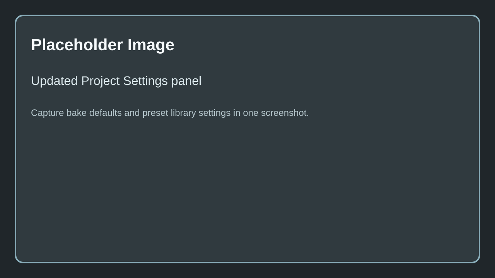

# Project Settings

Spline Architect exposes plugin-wide defaults in **Edit -> Project Settings -> Plugins -> Spline Architect Settings**.

 

Caption: Replace with the current Project Settings panel showing bake defaults and preset library asset path.

## Core defaults

### Corner Angle Increment
Controls how baked corner angles are rounded so the plugin can reuse generated corner meshes instead of creating a new asset for every tiny angle change.

### Default Wall Preset
Defines the default `FWallPreset` used when new wall-style content is created without a user-selected preset.

### Default Baked Mobility
Sets the mobility assigned to baked generated components.

### Default Bake Method
Sets the default bake output mode used by supported actors. Current values in code are:

- `Components`
- `Instanced`
- `Hierarchical Instanced`

### On Level Save Action
Controls what happens to supported Spline Architect root actors when the level is saved.

Options:

- `Nothing` - do not change actors on save
- `Rebake Unbaked` - bake only actors that are still unbaked
- `Rebake All` - force a bake on all supported actors
- `Unbake All` - return all supported actors to editable unbaked state

This is mainly useful when your project wants predictable baked output before packaging or source control submission.

### Preset Library
Points to the `SplineArchitectPresetLibrary` data asset used by the editor preset browser.

### Default Preset Library Asset Path
Fallback asset path used when the main preset library soft reference is unset. This gives the editor subsystem a default place to look for preset metadata.

## Notes

- Project settings define defaults. Per-actor values can still override bake mode, mobility, and preset choices.
- The preset library asset is an editor workflow layer on top of the underlying DataTables used for wall and building presets.

## Needed Images

- Updated Project Settings panel showing `Default Bake Method`, `Default Baked Mobility`, `Preset Library`, and `Default Preset Library Asset Path`

Full checklist: [Needed Images](../../5.Reference/1.Needed-Images.md)
