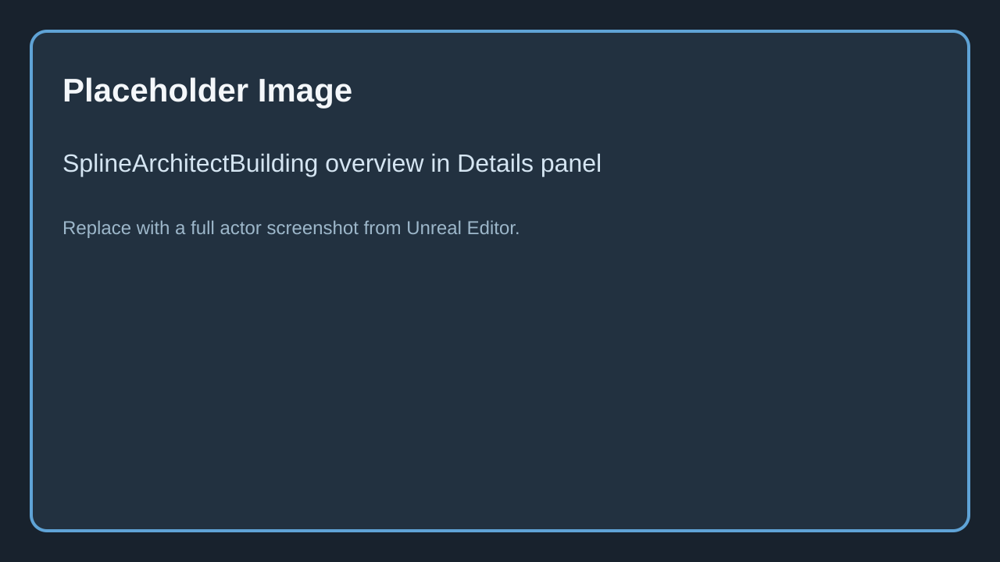
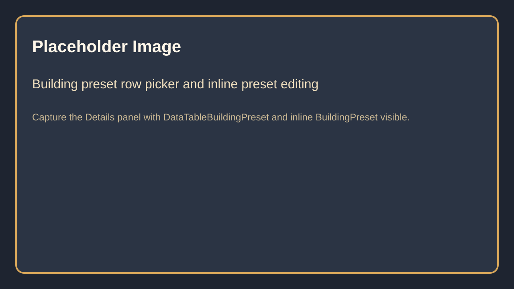
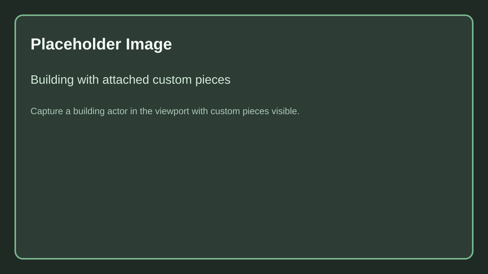

# SplineArchitectBuilding

## 1. What is `SplineArchitectBuilding`?

`SplineArchitectBuilding` is a footprint-driven actor that generates a complete building from a single spline plus a `BuildingPreset`.

Instead of authoring one wall actor at a time, the building actor resolves a stack or tree of wall presets, creates the generated output from that preset tree, and can also spawn building-level custom pieces attached to the building.

Caption: Replace with a screenshot of a `SplineArchitectBuilding` actor selected in the level with its full Details panel visible.

## 2. Spline requirements

- The actor needs a spline source to define the footprint.
- In practice, use a closed footprint for normal building generation.
- The actor can resolve a local spline component or an appropriate generation spline on the actor.
- `AutoGridify` and `GridSize` help keep footprint points clean when you are authoring rectangular or modular buildings.

## 3. Building preset workflow

`SplineArchitectBuilding` can read a preset from a DataTable row or use the inline `BuildingPreset` struct when no row is selected.

Caption: Replace with a screenshot of the building preset section showing DataTable row selection and inline preset editing.

### Main preset-related fields

| Field | Explanation |
|-------|-------------|
| `DataTableBuildingPreset` | Selects the `BuildingPreset` row used to build the actor. |
| `bRenameActorOnBuildingPresetSelection` | Renames the actor to the selected preset row name. |
| `BuildingPreset` | Inline preset data used when no DataTable row is selected or when editing the authored preset directly. |
| `Save Preset` | Writes the current building actor preset back to the configured DataTable row workflow. |

### What a building preset contains

A `BuildingPreset` contains:

- `Walls`: an array of `FBuildingWallNode` entries that define hierarchy, preset source, and optional overrides
- `CustomPieces`: an array of `FBuildingCustomPieceEntry` entries positioned relative to the building actor

This lets one actor drive multi-floor wall stacks, inline overrides, and reusable attached custom pieces from one footprint.

## 4. Baking and generation mode

| Field | Explanation |
|-------|-------------|
| `Baked` | Read-only state showing whether the actor is currently baked. |
| `GenerationMode` | Chooses between editor-oriented baked generation and runtime generation. |
| `BakeMethod` | Controls the baked component strategy used by temporary generation walls in baked mode. |
| `BakedMobility` | Sets mobility for generated components. |
| `CornerAngleIncrement` | Controls the temporary baked corner cache angle increment. |
| `Bake` | Regenerates and locks the building in baked mode. |
| `UnBake` | Restores an editable generated preview. |

Use baked mode when you want stable generated geometry in the editor. Use runtime mode only when your project intentionally wants the building to regenerate at runtime.

## 5. Controls

| Field | Explanation |
|-------|-------------|
| `Seed` | Randomization seed for the building generation. `-1` means choose a random seed. |
| `GridSize` | Local authoring grid used by helper actions and optional auto-grid snapping. |
| `AutoGridify` | Snaps spline points to the configured grid during authoring. |
| `ResetActorTransform` | Resets the actor transform to the spline. |
| `CenterActorTransform` | Moves the actor to the center of the footprint. |
| `GenerateRuntime` | Forces runtime-style generation immediately. |
| `ForceRegenerateTree` | Rebuilds the full generated output. |

## 6. Attached custom pieces

`SplineArchitectBuilding` can create or rebuild building-level custom pieces from preset entries. These pieces are tracked relative to the building actor rather than to an individual wall actor.

Caption: Replace with a screenshot showing a building actor with attached custom pieces generated from the preset.

This is useful for doors, facade inserts, repeated decorative elements, or authored extras that belong to the building as a whole.

## 7. When to use it

Use `SplineArchitectBuilding` when:

- one spline footprint should drive several coordinated wall presets
- you want reusable building definitions in DataTables
- you need building-level custom pieces authored as part of the preset
- authoring the same structure as multiple manually attached wall actors would be slower or more error-prone

## Needed Images

- Building actor overview in Details panel
- Building preset selection and inline preset editing
- Building actor with attached custom pieces

Full checklist: [Needed Images](../../5.Reference/1.Needed-Images.md)
