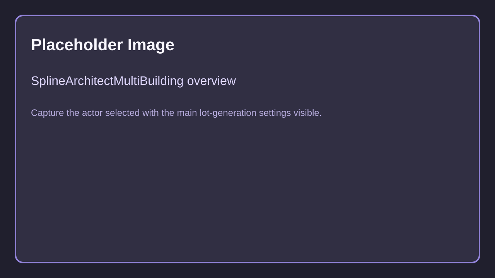
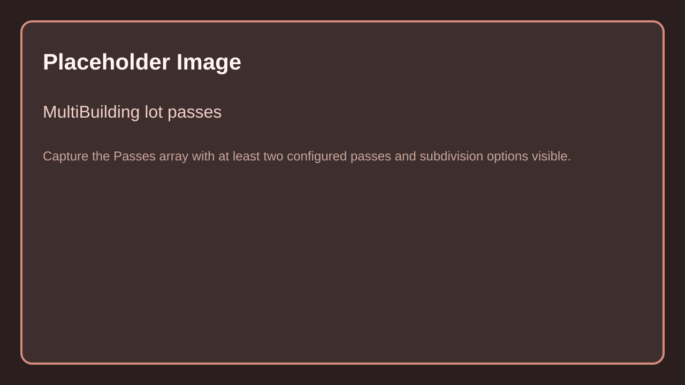
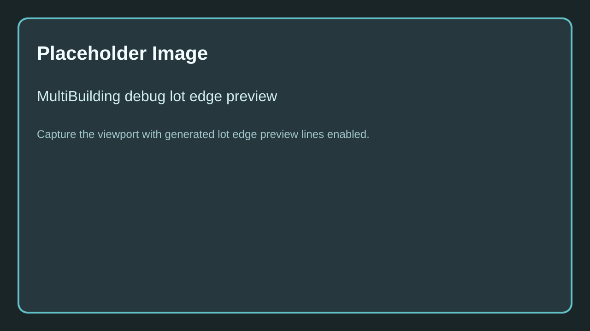
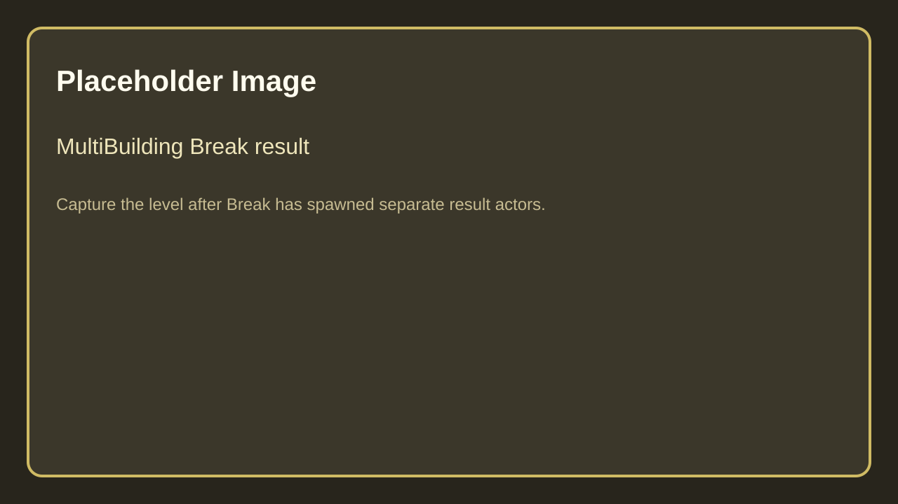

# SplineArchitectMultiBuilding

## 1. What is `SplineArchitectMultiBuilding`?

`SplineArchitectMultiBuilding` is a footprint-based actor for subdividing an area into lots and spawning repeated building or wall content across those lots.

It is meant for blockouts, neighborhoods, compounds, repeated structures, and any workflow where one closed boundary should generate many child results.

Caption: Replace with a screenshot of a `SplineArchitectMultiBuilding` actor selected with its main settings visible.

## 2. Spline requirements

- Use a closed spline footprint for the lot boundary.
- The actor resolves a spline source similarly to other spline hosts.
- `GridSize` and `AutoGridify` are useful for keeping the boundary predictable before subdivision begins.

## 3. Lot passes

The core workflow is the `Passes` array. Each pass can inset, subdivide, discard, merge, and optionally spawn content.

Caption: Replace with a screenshot of the `Passes` array configured with at least two passes and visible subdivision settings.

### Per-pass options

| Field | Explanation |
|-------|-------------|
| `LotZOffset` | Offsets the resulting pass lots vertically. |
| `Inset` | Shrinks lots before spawning or before later passes. |
| `Subdivision` | Controls target lot area, subdivision count, cut mode, irregularity, gap, lot merging, and lot discarding. |
| `SpawnMode` | Chooses `None`, `Building Preset`, or `Wall Preset`. |
| `Distribution` | Chooses random one-per-lot or spawn-on-all-lots behavior. |
| `BuildingPresets` | Candidate building presets when the pass spawns buildings. |
| `WallPresets` | Candidate wall presets when the pass spawns walls. |

### Subdivision terms

- `LotTargetAreaDividedBy100`: target lot area value scaled down in the UI
- `MaxSubdivisions`: how many split rounds the pass can attempt
- `CutMode`: `Angled` or `Straight`
- `Irregularity`: how much variation to introduce
- `Gap`: width carved between child lots
- `MergeLots`: percentage of successful cuts to skip
- `DiscardLots`: percentage of final lots to discard

## 4. Spawning behavior

Each generated lot can resolve either:

- a `BuildingPreset`, which spawns a transient `SplineArchitectBuilding`-style result
- a `WallPreset`, which spawns a transient `SplineArchitectWall`-style result

This makes the actor useful for mixing large building masses and simpler perimeter content with the same lot system.

## 5. Baking and runtime

`SplineArchitectMultiBuilding` follows the same broad pattern as the building actor:

- `GenerationMode` chooses baked vs runtime generation
- `BakeMethod` controls how baked content is emitted
- `BakedMobility` controls generated component mobility
- `CornerAngleIncrement` affects temporary baked corner handling
- `Bake`, `UnBake`, and `ForceRegenerateTree` rebuild the actor state
- `GenerateRuntime` forces the runtime path immediately

## 6. Debug preview and break workflow

The actor stores generated lots internally and can build a debug lot edge preview for the final pass.

Caption: Replace with a viewport screenshot showing debug lot edge preview lines for a generated multibuilding.

Use **Break** when you want to turn the generated lot results into separate spawned actors for further manual work.

Caption: Replace with a screenshot of a multibuilding after `Break`, showing separate resulting actors in the level.

## 7. Controls

| Field | Explanation |
|-------|-------------|
| `Seed` | Controls random lot assignment and preset choice. |
| `GridSize` | Authoring grid size for footprint cleanup. |
| `AutoGridify` | Automatically snaps the boundary spline to the grid. |
| `ResetActorTransform` | Resets the actor transform to the spline. |
| `CenterActorTransform` | Centers the actor to its footprint. |
| `Break` | Spawns break-out results for generated lots. |

## 8. When to use it

Use `SplineArchitectMultiBuilding` when:

- one outline should generate many independent lots
- you want procedural variation from several building presets
- you need quick blockouts for districts, compounds, or modular campuses
- manually placing each building would be slower than pass-based subdivision

## Needed Images

- Multi-building actor overview in Details panel
- Multi-building lot passes configured with at least two passes
- Multi-building debug lot edge preview in viewport
- Multi-building `Break` result example in level

Full checklist: [Needed Images](../../5.Reference/1.Needed-Images.md)
