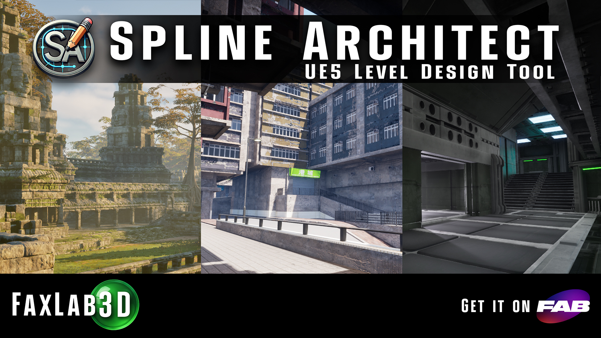

# Index
## Spline Architect - Procedural Walls, Buildings, and Structure Layouts With Splines

# [Trailer (YouTube)](https://www.youtube.com/watch?v=HEbpTogXNvM)

**Spline Architect** is an Unreal Engine 5 plugin for building walls, stacked structures, reusable building presets, and lot-based multi-building layouts directly from spline-driven actors and editor tools.

### Key Features

- Native UE spline workflows for walls, full buildings, and multi-building lot generation
- Non-destructive authoring in the editor, with baking or runtime generation depending on the actor
- Preset workflows for wall, building, and custom-piece content stored in DataTables and the Preset Library asset
- Editor Draw Mode for quickly drawing or editing supported spline hosts in the viewport
- Conversion tools that turn generated results into regular UE actors or mesh assets for projects that do not ship the plugin
- Reusable generated corner, floor, and roof assets where possible to avoid rebuilding identical geometry

{ width="200px" }
{ width="200px" }
{ width="200px" }
{ width="200px" }
{ width="200px" }

## Start Here

- [How it works](1.Intro/2.how-it-works.md)
- [SplineArchitectWall](2.Overview/Components/1.Spline-Architect-Wall.md)
- [SplineArchitectBuilding](2.Overview/Components/8.Spline-Architect-Building.md)
- [SplineArchitectMultiBuilding](2.Overview/Components/9.Spline-Architect-Multi-Building.md)
- [Draw Mode](2.Overview/Components/10.Draw-Mode.md)
- [Preset Library](2.Overview/Components/11.Preset-Library.md)
- [Needed Images](5.Reference/1.Needed-Images.md)
